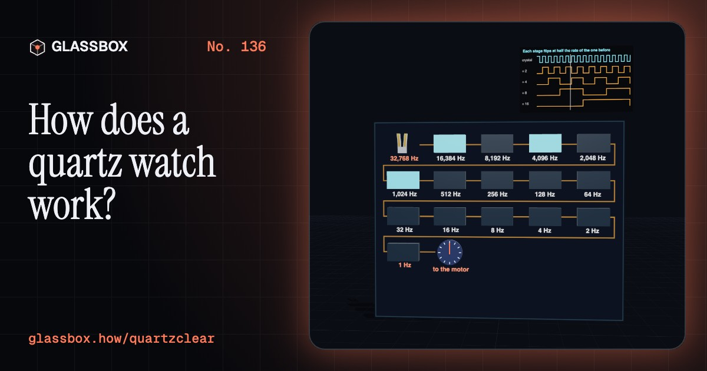
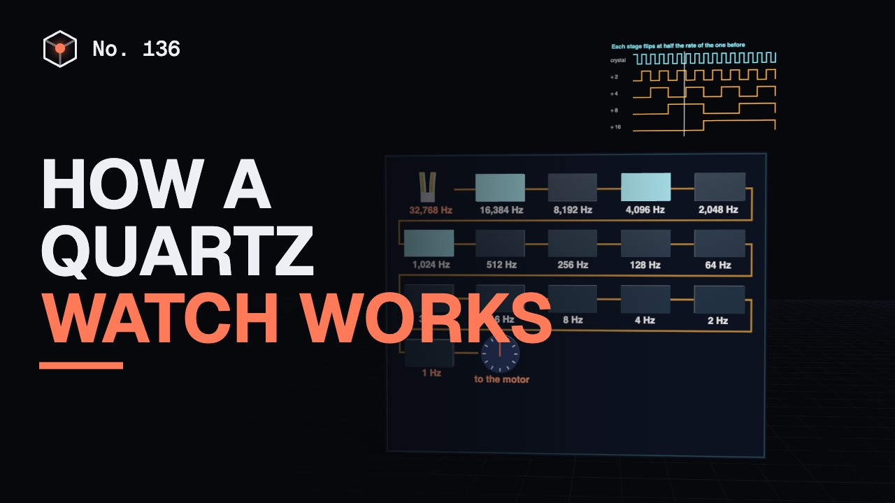
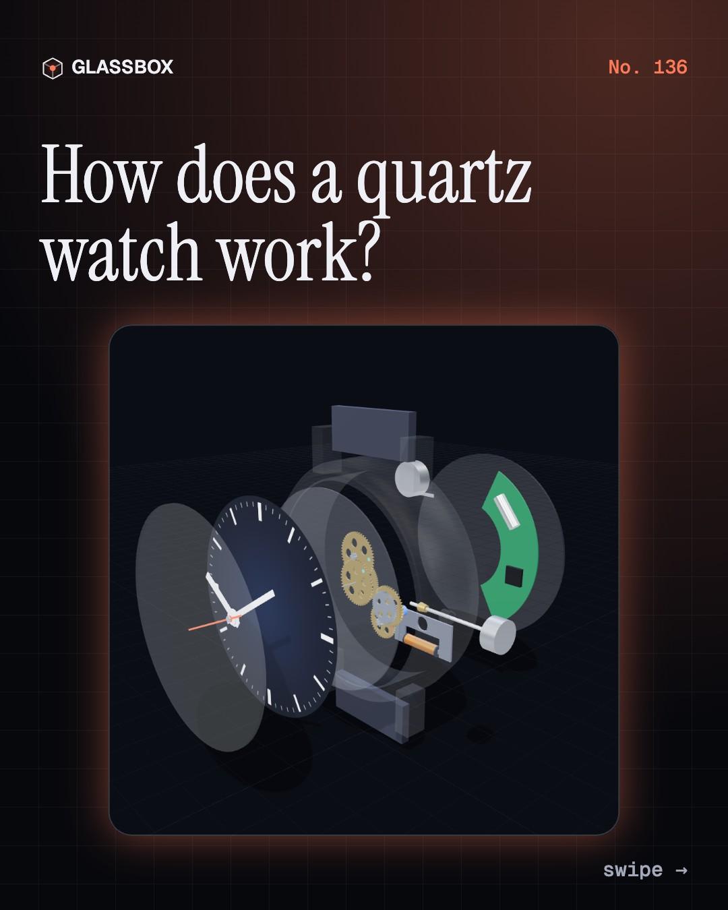
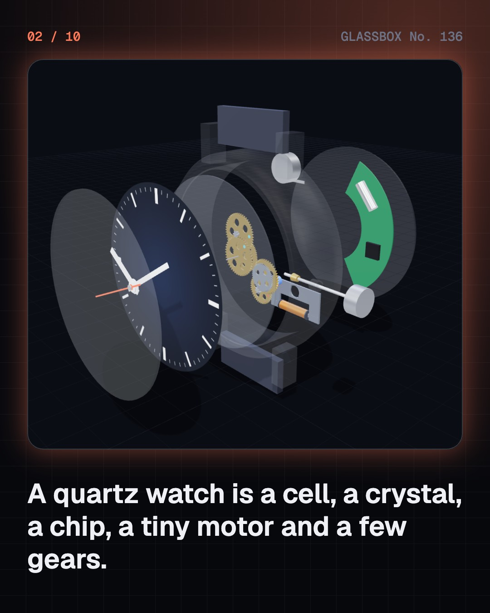
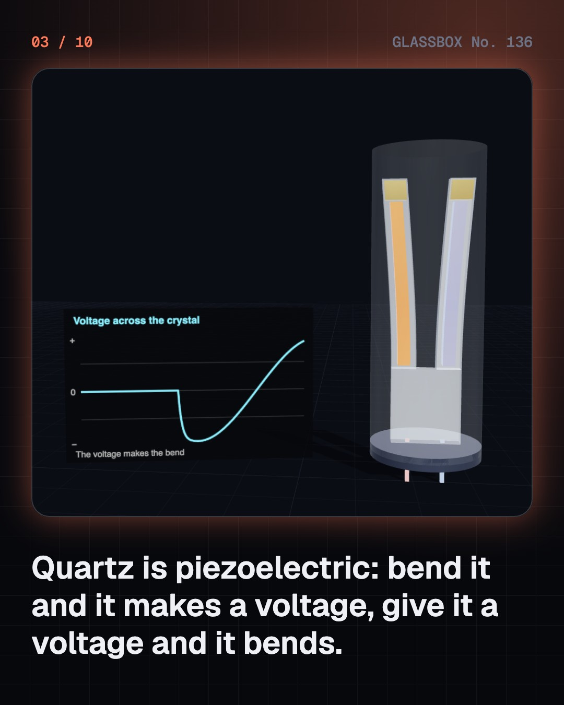
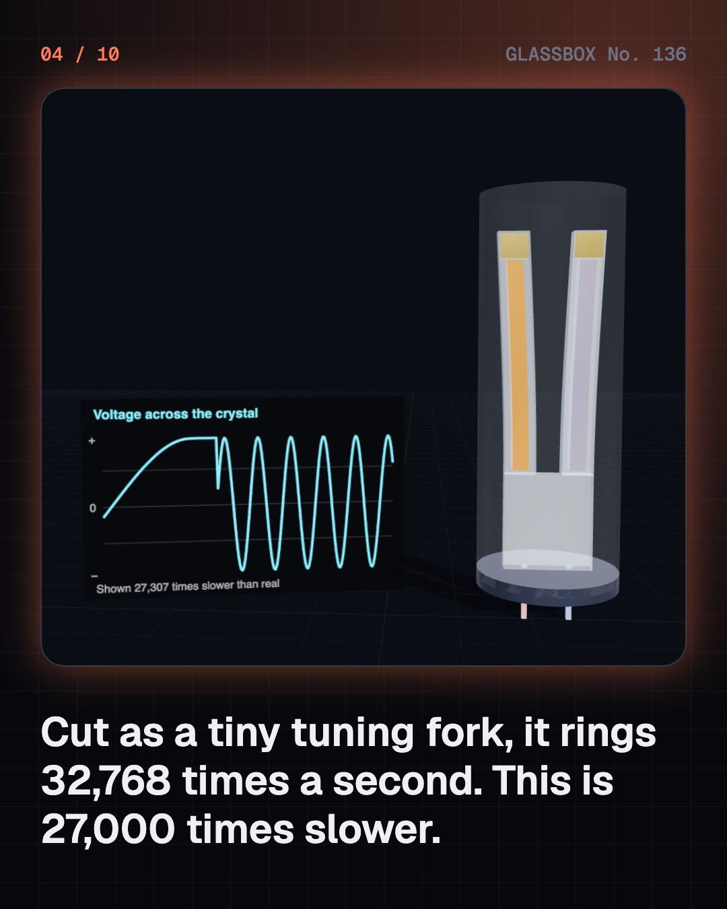

<!-- glassbox:start -->
<!-- Generated from glassbox.json by the Glassbox hub (npm run readme -- quartzclear). Edit glassbox.json, not this block. -->
<p align="center"><a href="https://glassbox.how/e/quartzclear/"></a></p>

<h1 align="center">QuartzClear</h1>

<p align="center"><b>How does a quartz watch work?</b><br>A sliver of quartz shaped like a tuning fork rings 32,768 times a second. A chip halves that beat fifteen times, and a magnet smaller than a grain of rice flips once a second. Take a quartz watch apart in 3D and see why it beats a mechanical watch a hundred times its price.</p>

<p align="center"><a href="https://glassbox.how/quartzclear/"><b>▶ Play with it</b></a> &nbsp;·&nbsp; <a href="https://glassbox.how/e/quartzclear/">Read the 60-second explainer</a> &nbsp;·&nbsp; <a href="https://glassbox.how/quartzclear/glassbox/reel.mp4">Watch the 40-second video</a></p>

<p align="center">
  <a href="https://glassbox.how/e/quartzclear/"></a>
  <a href="https://glassbox.how/e/quartzclear/"></a>
  <a href="LICENSE"></a>
  <a href="LICENSE-CONTENT.md"></a>
  <a href="#privacy"></a>
</p>

## In 60 seconds

1. **A cell, a crystal, a chip, a motor and gears.** An analog quartz watch has a silver-oxide button cell, a quartz crystal sealed in a tiny can, a chip, a coil with a flat iron stator, a magnet rotor, and a train of gears that turns the hands. The crown on the side stops the watch and sets it.
2. **A crystal that rings.** Quartz is piezoelectric: bend it and it makes a voltage, give it a voltage and it bends. Cut as a tuning fork about 3 mm long, it rings at 32,768 swings a second. The chip's oscillator listens to the fork and pushes it in step, so it never stops.
3. **Halving, fifteen times.** 32,768 is 2 multiplied by itself 15 times. A flip-flop halves the frequency of whatever pulses through it, so a chain of fifteen turns 32,768 Hz into 16,384, 8,192, and so on down to exactly one pulse a second.
4. **A motor that moves in ticks.** Each second the chip sends a pulse a few thousandths of a second long through the coil. The stator becomes a magnet and flips the two-pole rotor half a turn. Every pulse flows the opposite way to the last, and two notches in the stator make sure the rotor always turns forwards.
5. **Gears do the arithmetic.** The rotor makes 30 turns a minute. Gears with tooth ratios of 4, 6 and 1.25 slow it 30 times for the seconds hand. Two more pairs slow that 60 times for the minute hand, and the motion work under the dial slows that 12 times for the hour hand.
6. **Seconds a month, not seconds a day.** An ordinary quartz watch is rated to about 15 seconds a month, where a certified mechanical chronometer may drift 6 seconds a day. The crystal's weak spot is temperature: it runs truest near 25 °C and slows either side. The whole watch runs on about a millionth of a watt, so a tiny cell lasts for years.

## Words worth knowing

| Term | Meaning |
|---|---|
| **Piezoelectricity** | The way some crystals, like quartz, make a voltage when bent or squeezed, and bend when given a voltage. |
| **Quartz tuning fork** | A two-pronged sliver of quartz a few millimetres long that rings at 32,768 swings a second and sets the pace of the watch. |
| **Oscillator** | A circuit that keeps the crystal ringing by amplifying its tiny voltage and feeding it back in step. |
| **Flip-flop** | A small circuit whose output flips each time its input pulses, so it halves the frequency. Fifteen in a chain turn 32,768 Hz into 1 Hz. |
| **Lavet stepper motor** | A coil, a notched iron stator and a two-pole magnet rotor that turns exactly half a turn for each pulse. |
| **Gear ratio** | Teeth on the driven wheel divided by teeth on the driving one. Ratios in a train multiply: 30, then 60, then 12. |
| **Hacking** | Stopping the seconds hand when the crown is pulled out, so the watch can be set to the exact second. |
| **Turnover temperature** | The temperature, about 25 °C, at which the crystal runs fastest. Warmer or colder, the watch loses time. |
| **Q (quality factor)** | How cleanly something rings. A watch crystal's Q is about 70,000, a balance wheel's a few hundred. |

## A short history

**140 years from a squeezed crystal in a Paris lab to a watch that drifts by one second a year.**

- **1880** · Squeeze a crystal, get electricity (Pierre and Jacques Curie, Paris, France)
- **1921** · A crystal that holds one note (Walter Cady, Wesleyan University, Connecticut, USA)
- **1927** · The first quartz clock (Warren Marrison and Joseph Horton, Bell Telephone Laboratories, New York, USA)
- **1960** · The watch that hums (Max Hetzel and Bulova, New York, USA)
- **1967** · Beta 1: the first quartz wristwatch prototype (Centre Electronique Horloger (CEH), Neuchâtel, Switzerland)
- **1969** · The Seiko Quartz Astron goes on sale (Tsuneya Nakamura's team at Suwa Seikosha, Tokyo, Japan)
- **1970** · Tuning forks printed like chips (Juergen Staudte, California, USA)
- **1983** · Swatch: 51 parts and a plastic case (Ernst Thomke, Elmar Mock and Jacques Müller, Zürich, Switzerland)

The full story, with 30 moments, charts, people and 40 sources: [glassbox.how/e/quartzclear/history](https://glassbox.how/e/quartzclear/history/). The data lives in [`history.json`](history.json).

## Video and slides

Made with the Glassbox studio from this box's storyboard (`window.glassbox.director`). Free to reuse under CC BY 4.0.

<a href="https://glassbox.how/quartzclear/glassbox/video.mp4"></a>

<p><a href="glassbox/slide-1.jpg"></a> <a href="glassbox/slide-2.jpg"></a> <a href="glassbox/slide-3.jpg"></a> <a href="glassbox/slide-4.jpg"></a></p>

| File | What | Size |
|---|---|---|
| [`glassbox/reel.mp4`](https://glassbox.how/quartzclear/glassbox/reel.mp4) | Reel / Short, with captions and soundtrack | 1080×1920 |
| [`glassbox/video.mp4`](https://glassbox.how/quartzclear/glassbox/video.mp4) | YouTube video, with captions and soundtrack | 1920×1080 |
| `glassbox/slide-1…10.jpg` | Instagram carousel | 1080×1350 |
| `glassbox/thumb.jpg` | YouTube thumbnail | 1280×720 |
| `glassbox/cover.jpg` | Share card and repo social preview | 1200×630 |
| [`glassbox/history-reel.mp4`](https://glassbox.how/quartzclear/glassbox/history-reel.mp4) | “History in 10 moments” Reel / Short | 1080×1920 |
| `glassbox/history-slide-*.jpg` | History carousel | 1080×1350 |
| `glassbox/post.json` | Post copy and schedule used by the publish kit | |

## Privacy

This box has no accounts and no ads, and it ships its own fonts and libraries. When you run it yourself it sends nothing anywhere. On glassbox.how, the site's `/bar.js` also loads Glassbox's analytics: **Google Analytics** to count visits (it asks first in the EU, UK and Switzerland, and stays off when your browser sends Global Privacy Control or Do Not Track) and **ClickTrust** to detect bots.

It remembers a few things **in your own browser only**, and never sends them anywhere:

| Browser storage key | What it holds |
|---|---|
| `quartzclear.v1` | Which chapters you have opened, your best quiz scores, and sound on or off. |

Exactly what each one sees is at [glassbox.how/privacy](https://glassbox.how/privacy/).

## Licences

- **Code:** [MIT](LICENSE). Use it, change it, ship it.
- **Explanations, text, images and videos** (`glassbox.json`, `glassbox/`): [CC BY 4.0](LICENSE-CONTENT.md). Credit “Glassbox, glassbox.how/e/quartzclear”.
- **Third-party parts** keep their own licences: [three.js](https://threejs.org) (MIT), [Geist, Instrument Serif](https://openfontlicense.org) (SIL OFL 1.1).
- The Glassbox name and logo aren't covered by either licence. See the [terms](https://glassbox.how/terms/).

Found a mistake? [Open an issue](https://github.com/bdeeps/quartzclear/issues). Corrections happen in public.
<!-- glassbox:end -->

## Run it

It's plain HTML, CSS and JavaScript. No build step and no dependencies. Run locally, it contacts no other website.

```bash
python3 -m http.server 8000
```

Three.js and the fonts ship in `vendor/` and `fonts/`, so it also works offline.

Then open http://localhost:8000.

## How it's built

| File | What |
|---|---|
| `index.html`, `css/app.css` | The page and its styles |
| `js/app.js`, `js/stage.js`, `js/ui.js`, `js/kit.js` | The shared Glassbox 3D engine: chapters, 3D stage, controls, quiz, video director |
| `js/chapters/*.js` | One file per chapter: the 3D model, controls, text, key terms, quiz and video scenes |
| `js/watch.js` | The watch models and numbers shared by the chapters: meshing gears with real tooth counts, the Lavet stepper motor and its mechanics, a generic three-hand watch, the quartz tuning fork, and camera framing |
| `glassbox.json` | Title, question, explainer beats, key terms, browser storage and credits shown on glassbox.how |
| `reel` in each chapter | The storyboard the Glassbox studio records into short videos |
| `glassbox/` | The published video, slides, thumbnail and post copy |
| `fonts/`, `vendor/three/` | Self-hosted Geist and Instrument Serif (SIL OFL 1.1) and three.js (MIT) |
